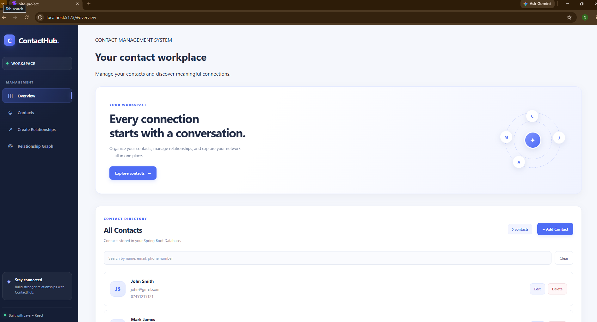
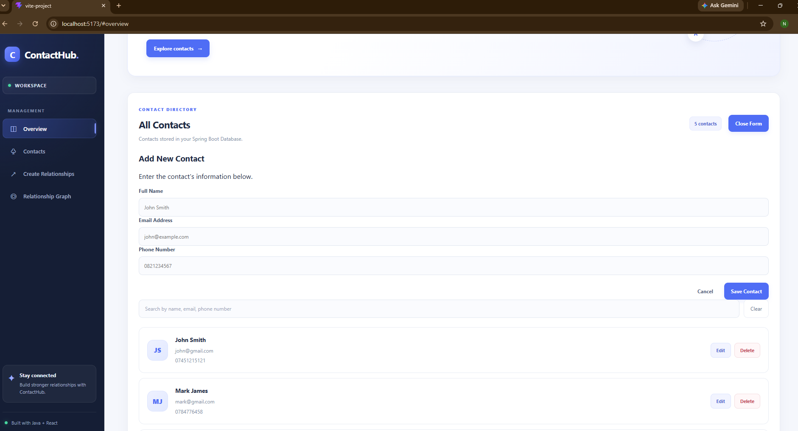
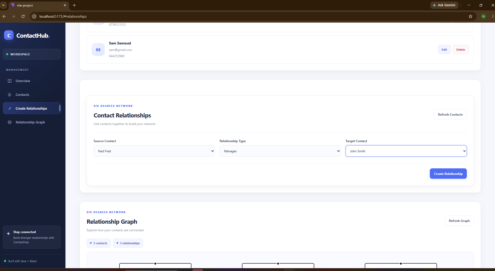
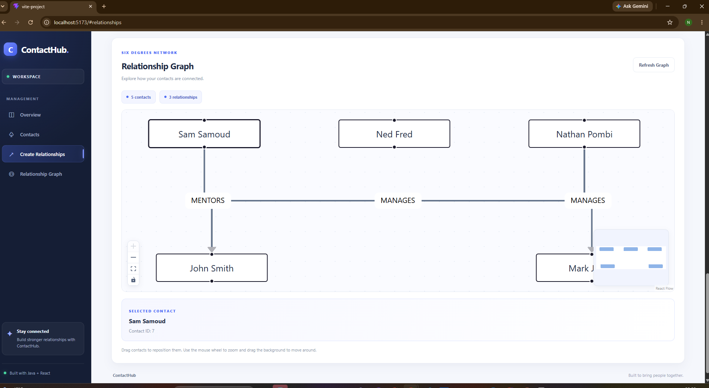

# ContactHub — Full-Stack Contact Management System


A full-stack Contact Management System built with **Java, Spring Boot, React, and PostgreSQL**, featuring contact management, searching, relationship tracking, and an interactive Six Degrees Network visualization.

Developed as part of the **ArithMatrix Virtual Internship Program (AVIP) 2026 — Task 3**.

## Live Application

- **Live Contact Management System (Deployed):** [Launch ContactHub](https://https://contacthub-frontend-fwqh.onrender.com/) it might take a few minutes to fully launch the backend due to Render
- **GitHub Repository:** [Source Code](https://github.com/NatePombi/SD_3_ContactManagement_byte)


---

## Project Overview

ContactHub enables users to manage contacts and visualize relationships between them.

In addition to standard CRUD functionality, the application includes a **Six Degrees Network**, allowing users to create directed relationships between contacts and explore their connections through an interactive graph.

The application uses a RESTful architecture, with React communicating with a Spring Boot backend and PostgreSQL providing persistent storage.

### Key Features

**Contact Management**
- Create new contacts.
- View all contacts.
- Update existing contact details.
- Delete contacts with confirmation.
- Search by name, email, or phone number.
- Validate user input.
- Prevent duplicate email addresses and phone numbers.
- Display loading, success, and error states.

**Relationship Management**
- Create relationships between existing contacts.
- Supported relationship types:
    - `MANAGES`
    - `MENTORS`
    - `KNOWS`
- Prevent self-relationships.
- Reject duplicate relationships.
- Store relationships persistently in PostgreSQL.
- Automatically remove associated relationships when a contact is deleted.

**Six Degrees Network**
- Visualize contacts as nodes.
- Display relationships as directed, labeled connections.
- Automatically arrange nodes using Dagre.
- Drag and reposition contacts.
- Zoom and pan around the graph.
- Use graph navigation controls and a minimap.
- Automatically refresh the graph after contact or relationship changes.
- Display contacts even when they have no relationships.

---

## Screenshots

### Contact Management Dashboard



### Add Contact



### Relationship Management



### Interactive Relationship Graph




---

## Technology Stack

### Backend

| Technology | Purpose |
|---|---|
| Java 17 | Backend programming language |
| Spring Boot | REST API development |
| Spring Web | HTTP controllers and endpoints |
| Spring Data JPA | Database persistence |
| Hibernate | Object-relational mapping |
| PostgreSQL | Relational database |
| Flyway | Database migrations |
| Jakarta Validation | Request validation |
| Maven | Dependency management and builds |
| Docker | Backend containerization |

### Frontend

| Technology | Purpose |
|---|---|
| React | User interface |
| JavaScript | Frontend logic |
| JSX | Component markup |
| CSS | Responsive styling |
| Vite | Development and production builds |
| Fetch API | Backend communication |
| React Flow | Interactive relationship visualization |
| Dagre | Automatic graph layout |

### Testing

- JUnit 5
- Mockito
- Spring Boot Test
- MockMvc
- PostgreSQL integration testing
- Node.js built-in test runner
- ESLint
- Manual API and browser testing

### Deployment

- Render Web Service — Spring Boot backend
- Render Static Site — React frontend
- Render PostgreSQL — managed database
- Docker — backend packaging
- GitHub — version control

---

## System Architecture

```text
                  USER / WEB BROWSER
                          |
                          v
                 REACT FRONTEND
               (Vite + React Flow)
                          |
                       HTTPS
                          |
                          v
                SPRING BOOT REST API
                          |
              +-----------+-----------+
              |                       |
              v                       v
       Contact Service      Relationship Service
              |                       |
              +-----------+-----------+
                          |
                          v
                 Spring Data JPA
                          |
                          v
                      Hibernate
                          |
                          v
                     PostgreSQL
                          |
                          v
                 Flyway Migrations
```

### Backend Architecture

The backend follows a layered architecture:

1. **Controller Layer:** Handles HTTP requests and responses.
2. **Service Layer:** Implements application business rules and transaction management.
3. **Repository Layer:** Provides database access through Spring Data JPA.
4. **Entity Layer:** Represents persistent database records.
5. **DTO Layer:** Defines request and response structures.
6. **Exception Handling:** Converts application errors into consistent HTTP responses.

This separation improves maintainability, testability, and code organization.

---

## REST API Documentation

### Contact Endpoints

Base path:

`/api/v1/contacts`

| Method | Endpoint                       | Description |
|---|--------------------------------|---|
| POST | `/api/v1/contacts`             | Create a contact |
| GET | `/api/v1/contacts/fetchAll`    | Retrieve all contacts |
| GET | `/api/v1/contacts/fetch/{id}`  | Retrieve a contact by ID |
| GET | `/api/v1/contacts?search=john` | Search contacts |
| PUT | `/api/v1/contacts/update/{id}` | Update a contact |
| DELETE | `/api/v1/contacts/delete/{id}` | Delete a contact |

### Example: Create Contact

**Request**

```http
POST /api/v1/contacts
Content-Type: application/json
```

```json
{
  "fullName": "John Smith",
  "email": "john@example.com",
  "phoneNumber": "0821234567"
}
```

**Successful response: HTTP 201 Created**

```json
{
  "id": 1,
  "fullName": "John Smith",
  "email": "john@example.com",
  "phoneNumber": "0821234567"
}
```

### Relationship Endpoints

Base path:

`/api/v1/relationships`

| Method | Endpoint | Description |
|---|---|---|
| POST | `/api/v1/relationships` | Create a relationship |
| GET | `/api/v1/relationships/contact/{contactId}` | Retrieve a contact's relationships |
| GET | `/api/v1/relationships/graph` | Retrieve the complete relationship graph |

### Example: Create Relationship

**Request**

```http
POST /api/v1/relationships
Content-Type: application/json
```

```json
{
  "sourceContactId": 1,
  "targetContactId": 2,
  "relationshipType": "MANAGES"
}
```

**Successful response: HTTP 201 Created**

The response contains the relationship ID, source and target contact IDs, their names, and relationship type.

### Example: Relationship Graph

**Request**

```http
GET /api/v1/relationships/graph
```

**Response**

```json
{
  "nodes": [
    {
      "id": 1,
      "name": "John Smith"
    },
    {
      "id": 2,
      "name": "Sarah Adams"
    }
  ],
  "edges": [
    {
      "id": 1,
      "sourceContactId": 1,
      "targetContactId": 2,
      "relationshipType": "MANAGES"
    }
  ]
}
```

The React frontend transforms these nodes and edges into the format required by React Flow.

---

## Database Design

The application uses PostgreSQL with Flyway-managed database migrations.

### Contacts Table

| Column | Description |
|---|---|
| `id` | Primary key |
| `full_name` | Contact's full name |
| `email` | Contact's email address |
| `phone_number` | Contact's phone number |

### Contact Relationships Table

| Column | Description |
|---|---|
| `id` | Relationship primary key |
| `source_contact_id` | Source contact |
| `target_contact_id` | Target contact |
| `relationship_type` | MANAGES, MENTORS, or KNOWS |

### Data Integrity

The database implements:

- Primary keys and foreign keys.
- Case-insensitive email uniqueness.
- Unique phone numbers.
- Duplicate relationship prevention.
- Self-relationship prevention.
- Restrictions on relationship types.
- Cascading deletion of relationships when contacts are removed.

Flyway migration scripts initialize and maintain the schema.

---


## Running the Application Locally

### Prerequisites

Install:

- Java 17
- Maven or use the included Maven Wrapper
- Node.js and npm
- PostgreSQL
- Docker Desktop (required for Testcontainers integration tests)
- Git

### 1. Clone the Repository

```bash
git clone https://github.com/NatePombi/SD_3_ContactManagement_byte
cd YOUR-REPOSITORY
```

### 2. Create the PostgreSQL Database

Create a local PostgreSQL database named:

```sql
CREATE DATABASE contact_management_db;
```

### 3. Configure Backend Environment Variables

Configure the following environment variables:

```dotenv
DB_URL=jdbc:postgresql://localhost:5432/contact_management_db
DB_USERNAME=postgres
DB_PASSWORD=YOUR_LOCAL_DATABASE_PASSWORD
```

Use your actual local PostgreSQL credentials.


### 4. Start Spring Boot

On Windows:

```powershell
cd backend
.\mvnw.cmd spring-boot:run
```

On macOS/Linux:

```bash
cd backend
./mvnw spring-boot:run
```

The backend normally runs at:

`http://localhost:8080`

Flyway automatically applies the database migrations.

### 5. Start React

Open a second terminal:

```bash
cd frontend
npm ci
npm run dev
```

Open the local URL shown by Vite, normally:

`http://localhost:5173`

During local development, Vite proxies `/api` requests to Spring Boot.

---

## Environment Configuration

### Backend

| Environment Variable | Purpose |
|---|---|
| `DB_URL` | PostgreSQL JDBC connection URL |
| `DB_USERNAME` | PostgreSQL username |
| `DB_PASSWORD` | PostgreSQL password |
| `PORT` | Backend HTTP server port |
| `APP_CORS_ALLOWED_ORIGINS` | Permitted frontend origin |

### Frontend

| Environment Variable | Purpose |
|---|---|
| `VITE_API_BASE_URL` | Public Spring Boot API base URL |

For local development, `VITE_API_BASE_URL` can be empty to use the Vite proxy.

For production, configure it using the deployed backend URL.


---

## Testing

### Backend Tests

The backend includes tests for:

- Contact creation, retrieval, updating, and deletion.
- Searching by name, email, and phone number.
- Request validation and exception handling.
- Duplicate contact prevention.
- Relationship creation and validation.
- Relationship graph retrieval.
- PostgreSQL database constraints.
- Foreign-key integrity and cascading deletes.
- Flyway migration execution.


Run:

```bash
cd backend
./mvnw test
```

On Windows:

```powershell
.\mvnw.cmd test
```

Docker Desktop must be running for the Testcontainers tests.

### Frontend Tests

The graph mapper includes seven automated tests covering:

- Backend contact-to-node conversion.
- Directed relationship mapping.
- Multiple relationship types.
- Reverse-direction relationships.
- Isolated contacts.
- Invalid API responses.
- Empty graphs.

**Verified milestone:** 7 passing graph mapper tests.

Run:

```bash
cd frontend
npm test
```

Run frontend quality checks:

```bash
npm run lint
npm run build
```

The frontend CRUD and graph workflows have also been manually verified against the Spring Boot API and PostgreSQL database.

---

## Deployment

The application is deployed using Render.

### PostgreSQL

A managed PostgreSQL database stores contacts and relationships.

The backend connects using Render's internal database hostname and environment variables.

Flyway automatically initializes the database schema.

### Spring Boot Backend

The Spring Boot API runs as a Docker-based Render Web Service.

The Dockerfile uses a multi-stage build:

1. Maven compiles and packages the backend.
2. A Java runtime image executes the Spring Boot JAR.

### React Frontend

React is deployed as a Render Static Site.

Build command:

```bash
npm ci && npm run build
```

Publish directory:

```text
dist
```

The frontend uses `VITE_API_BASE_URL` to communicate with the deployed Spring Boot backend.

Production CORS is configured to allow requests from the deployed frontend origin.

---

## Engineering Decisions

### Layered Backend Architecture

Controllers, services, repositories, DTOs, and entities are separated to improve maintainability and enable isolated testing.

### Database-Level Constraints

Application validation is supported by PostgreSQL constraints to protect data integrity even when requests bypass the frontend.

### Flyway Database Migrations

Versioned migrations make database schema changes repeatable across development and deployment environments.

### Reusable React Components

Contact cards, forms, the relationship manager, and graph visualization are organized into separate components.

### Centralized API Configuration

The frontend uses a shared API configuration utility rather than hardcoded backend URLs.

### Graph Layout and Mapping

A dedicated graph mapper converts backend responses into React Flow nodes and edges. Dagre calculates the initial graph layout.

### Automated Testing

Unit, controller, integration, and graph mapper tests help verify application behavior and guard against regressions.

---

## Current Limitations

- User authentication and authorization are not yet implemented.
- Publicly accessible write endpoints are not suitable for storing real personal contact data.
- Graph node positions are not persisted after dragging.
- Hosting availability and data retention depend on the selected Render plans.

---

## Future Improvements

- JWT authentication and role-based authorization.
- User-specific contact directories.
- Contact pagination and server-side filtering.
- Contact import and export.
- More advanced graph search and filtering.
- Persistent graph node positioning.
- Expanded React component and end-to-end testing.
- Production monitoring and observability.

---

## Internship Project

**Program:** ArithMatrix Virtual Internship Program (AVIP) 2026

**Task:** Task 3 — Contact Management System

The project demonstrates practical experience with:

- Full-stack software development.
- Java and Spring Boot REST APIs.
- Relational database design.
- Data validation and integrity.
- Automated testing.
- React state management.
- Interactive graph visualization.
- Docker and cloud deployment.
- Git and GitHub version control.

---

## Developer

**Nathan Pombi**

Software Development Graduate

**Specialization:** Java Backend Development Applications

**Technologies:** Java, Spring Boot, PostgreSQL, React, Docker, GitHub


---

## License

No license has been specified for this project.

Copyright © 2026 Nathan Pombi.
